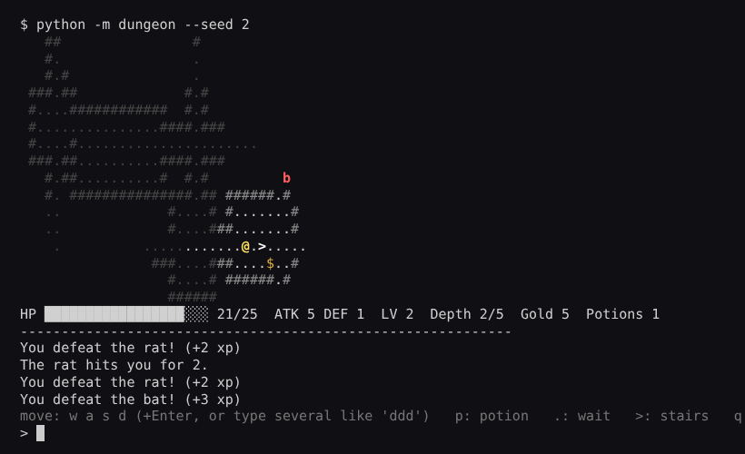

# 🗡️ Terminal Dungeon

A tiny turn-based roguelike that runs in your terminal. Every game generates a new dungeon of rooms and corridors. You explore with limited vision, fight monsters that hunt you down with pathfinding, collect gold and gear, and try to get through all 5 floors alive.

It's written in plain Python with **no dependencies**, and it was my excuse to implement some classic algorithms properly: procedural generation, Bresenham lines, field of view and breadth-first search.



## Playing

```bash
git clone https://github.com/blackdalc7/terminal-dungeon.git
cd terminal-dungeon
PYTHONPATH=src python -m dungeon               # Windows PowerShell: $env:PYTHONPATH="src"; python -m dungeon
PYTHONPATH=src python -m dungeon --seed 42     # the same dungeon every time
```

Type a command and press Enter. You can type several moves at once, like `dddd` to walk four steps right.

| Key | Action |
|---|---|
| `w` `a` `s` `d` | move up / left / down / right (walk into a monster to attack it) |
| `p` | drink a healing potion |
| `.` or just Enter | wait a turn |
| `>` | go down the stairs |
| `q` | quit |

### What's on the map

| Symbol | Meaning |
|---|---|
| `@` | you |
| `#` / `.` | wall / floor (dim = remembered but out of sight) |
| `>` | stairs down |
| `$` `!` `/` `]` | gold, healing potion, better sword (+2 ATK), better shield (+1 DEF) |
| `r` `b` `g` `s` `o` `T` | rat, bat, goblin, skeleton, orc, troll. Tougher ones appear deeper |

Kill monsters to gain XP and level up (more HP and attack). Your score at the end is gold + 10 per kill + 100 per floor reached, and +500 if you make it out of floor 5.

## How it works

```
src/dungeon/
├── mapgen.py   rooms + corridors generator, the Map class
├── fov.py      Bresenham line, field of view, BFS pathfinding
├── game.py     entities, combat, items, levelling, monster turns, floors
├── render.py   turns the game into (optionally coloured) text
└── cli.py      the input loop
```

### 1. Dungeon generation (`mapgen.py`)

1. Start with a grid that is solid wall.
2. Try to place up to 12 rectangles of random size at random positions, skipping any that overlap an existing room (with a 1-tile gap).
3. Join each new room to the previous one with an **L-shaped corridor** between their centres (randomly horizontal-first or vertical-first).
4. Put the stairs in the centre of the last room.

Because every room is connected to the one before it, the whole dungeon is always connected. A test checks this for 25 different seeds by pathfinding from the first room to every other room.

### 2. Field of view (`fov.py`)

For every cell within a 7-tile radius, draw a straight line from the player to it with **Bresenham's line algorithm**, and walk along the line until it hits a wall. Everything passed along the way is visible, including the wall that stopped it. Cells you've seen before are remembered and drawn dimmed, like a map you're filling in.

### 3. Monster AI (`fov.py` + `game.py`)

Monsters you can't see are asleep. Awake monsters use **breadth-first search** to find the shortest path to you, and take one step along it each turn. If they are next to you, they attack instead. Other monsters count as obstacles, so they spread out and come around corridors instead of stacking up.

```python
came_from = {start: None}
queue = deque([start])
while queue:
    current = queue.popleft()
    if current == goal:
        break
    for nxt in neighbours(current):
        if nxt not in came_from and walkable(nxt):
            came_from[nxt] = current
            queue.append(nxt)
# then walk back from the goal to find the first step
```

### 4. Combat

`damage = max(1, attack - defence + random(-1, 0, +1))`, so even a strong defence can't make you invincible.

### Seeds

All randomness goes through one `random.Random(seed)`, so `--seed 42` gives the same dungeon, monsters and dice rolls every time. This made the game much easier to test and debug.

## Tests

```bash
pip install -r requirements-dev.txt
pytest --cov
ruff check .
```

57 tests (about 98% coverage) check things like: walls block sight, BFS goes around walls and gives up when there's no path, every room is reachable, picking up each item type, levelling up, monsters chasing and attacking, sleeping monsters staying put, death, and winning on the last floor. The input loop is tested by passing in fake `read`/`write` functions instead of the real keyboard.

While balancing, I wrote a small bot that just runs straight for the stairs without picking anything up. It escapes about 1 game in 6, so a player who explores, levels up and uses potions should do a lot better.

## Ideas for later

- [ ] Real-time keys with `curses` (Linux/macOS) or `msvcrt` (Windows) so you don't need Enter
- [ ] Ranged enemies and a bow
- [ ] Save and load
- [ ] A high-score table

## License

MIT, see [LICENSE](LICENSE).
